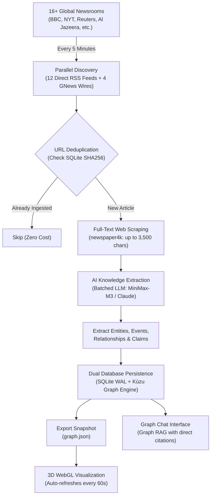

# DriftForge — Persistent News Knowledge Graph & Graph Chat

DriftForge is an automated, real-time news intelligence platform. It continuously reads breaking news across **16+ major global newsrooms**, extracts full article bodies, discovers entities and their real-world relationships using AI, and turns them into a live **interactive 3D Knowledge Graph** and conversational **Graph Chat** (Graph RAG).

---

## 💡 What is DriftForge in Simple Terms?

Imagine having an AI research assistant that never sleeps:
1. **Reads World News Every 5 Minutes**: It constantly scans 16 top global news organizations (BBC, New York Times, Reuters, Bloomberg, etc.) for breaking stories.
2. **Scrapes the Full Article**: Instead of just reading short headlines, it downloads and reads the **entire article text** (up to 3,500 characters) to understand full context and nuance.
3. **Understands Who Did What to Whom**: Using an advanced LLM, it extracts key actors (*people, governments, corporations, armed groups*), events (*treaties, sanctions, conflicts, statements*), and how they are connected (*opposes, supports, threatens, investigates*).
4. **Builds a 3D Web of World Events**: Every relationship and evidentiary claim is stored and rendered as a navigable, glowing 3D universe in your browser that auto-refreshes every minute.
5. **Enables Graph Chat**: You can chat directly with this knowledge graph to get factual, evidence-backed answers with citations pointing back to the original news articles.

---

## 🎬 Demo Walkthrough

Watch the complete demonstration showcasing the interactive 3D Knowledge Graph, real-time entity navigation, and evidence-grounded Graph Chat:

🎬 **[Stream / Watch Demo Video](https://media.githubusercontent.com/media/Import-Saurabh/Knowledge_Graph/main/Media/Screen%20Recording%202026-10-12%20161635.mp4)** · **[View in Repository](Media/Screen%20Recording%202026-10-12%20161635.mp4)**

---

## 🌐 Monitored Media Houses & Outlets

DriftForge monitors **16+ premier global newsrooms** across diverse geopolitical perspectives:

| Region / Focus | Outlet | Ingestion Method | Coverage |
|---|---|---|---|
| 🇬🇧 United Kingdom | **BBC News World** | Direct RSS | Global / Politics / Conflict |
| 🇬🇧 United Kingdom | **The Guardian World** | Direct RSS | International Diplomacy & Environment |
| 🇺🇸 United States | **The New York Times** | Direct RSS | Global Affairs & Geopolitics |
| 🇺🇸 United States | **NPR News** | Direct RSS | US & World In-Depth Reporting |
| 🇺🇸 United States | **The Washington Post** | GNews Real-time Wire | US Policy & Global Security |
| 🇺🇸 United States | **Bloomberg** | GNews Real-time Wire | Global Economy, Markets & Trade |
| 🇺🇸 United States | **Business Insider** | Direct RSS | Tech, Business & Global Markets |
| 🇬🇧 International | **Reuters** | GNews Real-time Wire | Breaking Financial & Geopolitical News |
| 🇪🇺 Europe | **Euronews** | Direct RSS | Pan-European News & Policy |
| 🇩🇪 Germany | **Deutsche Welle (DW)** | Direct RSS | European & World Affairs |
| 🇫🇷 France | **France 24** | Direct RSS | Francophone & International Affairs |
| 🇶🇦 Middle East | **Al Jazeera English** | Direct RSS | Middle Eastern & Global Perspectives |
| 🇮🇷 Middle East | **Tehran Times** | Direct RSS | Middle East & Iranian Geopolitics |
| 🇷🇺 Eastern Europe | **The Moscow Times** | Direct RSS | Russian & Regional Developments |
| 🇮🇳 South Asia | **The Times of India** | Direct RSS | South Asian & Global Developments |
| 🇨🇳 East Asia | **Global Times** | GNews Real-time Wire | East Asian & Chinese Perspectives |

---

## ⏱️ Update Interval & Pipeline Cadence

- **Background Ingestion Frequency**: Runs automatically **every 5 minutes** (`INGESTION_SCHEDULE_MINUTES=5`).
- **Discovery Speed**: Concurrently queries all 16 feeds in parallel threads in **under 4 seconds**.
- **Scraping Speed**: Uses `newspaper4k` across 10 concurrent worker threads with strict 3.5s per-page deadlines (with enforced thread-level timeouts).
- **Pacing & Throughput**: Each cycle processes up to 50 fresh, unseen articles in concurrent LLM batches. GNews and RSS articles are interleaved so no source is starved.
- **Frontend Auto-Refresh**: The 3D graph web interface checks for updates every **60 seconds**, seamlessly refreshing the 3D visualization when new nodes arrive without reloading the page.

---

## 🔄 End-to-End Pipeline (From Article to 3D Graph)



---

## 🚀 Setup Guide (Complete — from scratch to running)

### Prerequisites

| Tool | Minimum Version | Check |
|---|---|---|
| Python | 3.10+ | `python --version` |
| pip | 21+ | `pip --version` |
| Git | 2.30+ | `git --version` |
| Docker *(optional)* | 20.10+ | `docker --version` |
| Docker Compose *(optional)* | 2.0+ | `docker compose version` |

### Option A: Run Locally (without Docker)

#### 1. Clone the Repository
```bash
git clone https://github.com/Import-Saurabh/Knowledge_Graph.git
cd Knowledge_Graph
```

#### 2. Create & Activate Virtual Environment
```bash
# Create virtual environment
python -m venv .venv

# Activate — choose your OS:
# Windows (PowerShell):
.venv\Scripts\Activate.ps1
# Windows (cmd):
.venv\Scripts\activate.bat
# macOS / Linux:
source .venv/bin/activate
```

#### 3. Install Dependencies
```bash
pip install --upgrade pip
pip install -r requirements.txt
```

**Verify key packages installed:**
```bash
python -c "import newspaper; print('newspaper4k OK')"
python -c "import gnews; print('gnews OK')"
python -c "import kuzu; print('kuzu OK')"
python -c "import anthropic; print('anthropic OK')"
```

#### 4. Configure Environment Variables
```bash
# Copy the template
cp .env.example .env

# Then edit .env with your editor — the only REQUIRED change:
# ANTHROPIC_API_KEY=your_actual_api_key_here
```

**Key settings in `.env`:**
| Variable | Default | Description |
|---|---|---|
| `ANTHROPIC_API_KEY` | *(required)* | Your MiniMax or Anthropic API key |
| `ANTHROPIC_BASE_URL` | `https://api.minimax.io/anthropic` | LLM endpoint |
| `LLM_MODEL` | `MiniMax-M3` | Model name |
| `PORT` | `8080` | Server port |
| `INGESTION_SCHEDULE_MINUTES` | `5` | Background ingestion interval |
| `MAX_PROCESS_PER_RUN` | `50` | Articles processed per cycle |
| `SCHEDULER_ENABLED` | `true` | Enable/disable auto-ingestion |

#### 5. Initialize & Run the Server
```bash
# Start the server (the database initializes automatically on first run)
python -m uvicorn server.app:app --host 127.0.0.1 --port 8080

# Or with auto-reload for development:
python -m uvicorn server.app:app --host 127.0.0.1 --port 8080 --reload
```

#### 6. Open in Browser
| Page | URL |
|---|---|
| 3D Knowledge Graph | http://127.0.0.1:8080 |
| Graph Chat | http://127.0.0.1:8080/chat |
| API Docs (Swagger) | http://127.0.0.1:8080/docs |
| Health Check | http://127.0.0.1:8080/api/health |

---

### Option B: Run with Docker (recommended for any machine)

#### 1. Clone & Configure
```bash
git clone https://github.com/Import-Saurabh/Knowledge_Graph.git
cd Knowledge_Graph
cp .env.example .env
# Edit .env — set ANTHROPIC_API_KEY=your_actual_api_key_here
```

#### 2. Build & Start
```bash
# Build the image and start the container
docker compose up --build -d

# View logs
docker compose logs -f driftforge

# Check health
curl http://localhost:8080/api/health
```

#### 3. Stop & Restart
```bash
# Stop
docker compose down

# Stop and remove data volume (full reset)
docker compose down -v

# Restart
docker compose up -d
```

Data is persisted in a Docker volume (`driftforge-data`) at `/app/data` inside the container.

---

## 🧪 Testing

Run the full automated test suite:
```bash
# Activate virtual environment first
pytest tests/ -v
```

---

## 📡 API Reference Summary

| Method | Endpoint | Description |
|---|---|---|
| `GET` | `/api/health` | Health check with live entity, relationship, and article counts |
| `GET` | `/api/graph` | Retrieve graph nodes and links for 3D visualization |
| `GET` | `/api/graph/subgraph` | Multi-hop neighborhood traversal (`?nodes=id1,id2&hops=2`) |
| `GET` | `/api/entities/search` | Full-text search across entities and aliases (`?q=query`) |
| `GET` | `/api/entities/{id}` | Entity metadata, aliases, and connected relationships |
| `POST` | `/api/query` | Conversational Graph RAG question answering |
| `GET` | `/api/conversations` | List persistent conversation sessions |
| `POST` | `/api/ingest` | Trigger manual news ingestion (`X-API-Key: ADMIN_API_KEY`) |
| `GET` | `/api/ingest/status` | Ingestion job history and performance metrics |

---

## 📄 License
MIT License. Built by [Import-Saurabh](https://github.com/Import-Saurabh).
