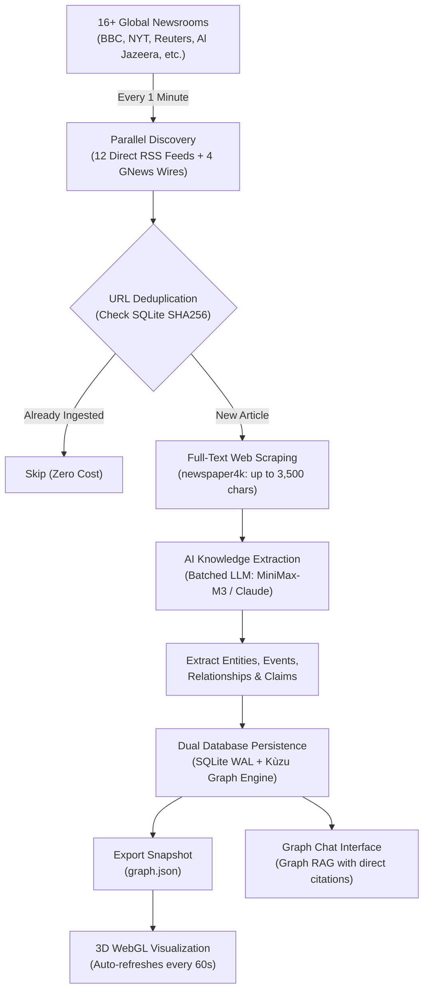

# DriftForge — Persistent News Knowledge Graph & Graph Chat

DriftForge is an automated, real-time news intelligence platform. It continuously reads breaking news across **16+ major global newsrooms**, extracts full article bodies, discovers entities and their real-world relationships using AI, and turns them into a live **interactive 3D Knowledge Graph** and conversational **Graph Chat** (Graph RAG).

---

## 💡 What is DriftForge in Simple Terms?

Imagine having an AI research assistant that never sleeps:
1. **Reads World News Every 60 Seconds**: It constantly scans 16 top global news organizations (BBC, New York Times, Reuters, Bloomberg, etc.) for breaking stories.
2. **Scrapes the Full Article**: Instead of just reading short headlines, it downloads and reads the **entire article text** (up to 3,500 characters) to understand full context and nuance.
3. **Understands Who Did What to Whom**: Using an advanced LLM, it extracts key actors (*people, governments, corporations, armed groups*), events (*treaties, sanctions, conflicts, statements*), and how they are connected (*opposes, supports, threatens, investigates*).
4. **Builds a 3D Web of World Events**: Every relationship and evidentiary claim is stored and rendered as a navigable, glowing 3D universe in your browser that auto-refreshes every minute.
5. **Enables Graph Chat**: You can chat directly with this knowledge graph to get factual, evidence-backed answers with citations pointing back to the original news articles.

> 📦 **Cloning & Proof of Evidence**: Pre-populated database files (`data/driftforge.db` & `data/kuzu_store`) and `graph.json` containing **500+ entities and 700+ relationships** are committed into this repository. Anyone cloning the project can immediately launch it and explore live proof-of-evidence history out of the box—no cold start needed!

---

## 🎬 Demo Walkthrough

Watch the complete demonstration showcasing the interactive 3D Knowledge Graph, real-time entity navigation, and evidence-grounded Graph Chat:

🎬 **[Stream / Watch Demo Video](https://media.githubusercontent.com/media/Import-Saurabh/Knowledge_Graph/main/Media/Screen%20Recording%202026-10-12%20161635.mp4)** · **[View in Repository](Media/Screen%20Recording%202026-10-12%20161635.mp4)**

---

## 🌐 Monitored Media Houses & Outlets

DriftForge monitors **16+ premier global newsrooms** across diverse geopolitical perspectives:

| Region / Focus | Outlet | Ingestion Method | Coverage |
|---|---|---|---|
| 🇬🇧 United Kingdom | **BBC News World** | Direct RSS | Global / Politics / Conflict |
| 🇬🇧 United Kingdom | **The Guardian World** | Direct RSS | International Diplomacy & Environment |
| 🇺🇸 United States | **The New York Times** | Direct RSS | Global Affairs & Geopolitics |
| 🇺🇸 United States | **NPR News** | Direct RSS | US & World In-Depth Reporting |
| 🇺🇸 United States | **The Washington Post** | GNews Real-time Wire | US Policy & Global Security |
| 🇺🇸 United States | **Bloomberg** | GNews Real-time Wire | Global Economy, Markets & Trade |
| 🇺🇸 United States | **Business Insider** | Direct RSS | Tech, Business & Global Markets |
| 🇬🇧 International | **Reuters** | GNews Real-time Wire | Breaking Financial & Geopolitical News |
| 🇪🇺 Europe | **Euronews** | Direct RSS | Pan-European News & Policy |
| 🇩🇪 Germany | **Deutsche Welle (DW)** | Direct RSS | European & World Affairs |
| 🇫🇷 France | **France 24** | Direct RSS | Francophone & International Affairs |
| 🇶🇦 Middle East | **Al Jazeera English** | Direct RSS | Middle Eastern & Global Perspectives |
| 🇮🇷 Middle East | **Tehran Times** | Direct RSS | Middle East & Iranian Geopolitics |
| 🇷🇺 Eastern Europe | **The Moscow Times** | Direct RSS | Russian & Regional Developments |
| 🇮🇳 South Asia | **The Times of India** | Direct RSS | South Asian & Global Developments |
| 🇨🇳 East Asia | **Global Times** | GNews Real-time Wire | East Asian & Chinese Perspectives |

---

## ⏱️ Update Interval & Pipeline Cadence

- **Background Ingestion Frequency**: Runs automatically **every 1 minute** (`INGESTION_SCHEDULE_MINUTES=1`).
- **Discovery Speed**: Concurrently queries all 16 feeds in parallel threads in **under 4 seconds**.
- **Scraping Speed**: Uses `newspaper4k` across 10 concurrent worker threads with strict 3.5s per-page deadlines.
- **Pacing & Low Latency**: Each cycle processes the top 10 fresh, unseen articles in 2 parallel LLM batches, completing in **~12–15 seconds** without hitting rate limits.
- **Frontend Auto-Refresh**: The 3D graph web interface checks for updates every **60 seconds**, seamlessly refreshing the 3D visualization when new nodes arrive without reloading the page.

---

## 🔄 End-to-End Pipeline (From Article to 3D Graph)



### 1. Parallel Harvesting (Every 60 Seconds)
The scheduler wakes up every minute and queries all 16 newsrooms simultaneously. Up to 30 recent articles per feed are collected, preventing fast-breaking news cycles from dropping stories.

### 2. Instant Database Deduplication
Before performing any web scraping or LLM calls, every article URL is normalized and checked against SQLite (`SHA256(clean_url)`). Already-stored articles are instantly skipped, consuming zero extra bandwidth or LLM tokens.

### 3. Full-Text Web Scraping (`newspaper4k`)
Instead of relying on truncated 2-sentence RSS snippets, DriftForge fetches the complete article webpage and parses clean editorial body text (up to 3,500 characters). If an outlet blocks access or times out, it gracefully falls back to the RSS summary.

### 4. Structured AI Extraction
Articles are batched into groups of 5 and processed concurrently by an LLM with strict JSON schema instructions:
- **Entities**: Resolves canonical actors (`person`, `organisation`, `country`, `location`, `government`, `armed_group`, `concept`).
- **Events**: Discrete occurrences with timestamps and locations (`military_action`, `diplomatic_meeting`, `agreement`, `sanctions`, etc.).
- **Directed Relationships**: High-fidelity semantic connections (`opposes`, `supports`, `threatens`, `causes`, `allies_with`, `sanctions`).
- **Evidentiary Claims**: Verifiable factual statements tagged with source attribution and exact article index.

### 5. Dual Database Persistence
- **SQLite (WAL mode)**: Stores entities, aliases, relationships, events, full article texts, full-text search indexes (`FTS5`), and chat logs.
- **Kùzu Graph Engine**: Embedded property graph database allowing high-speed multi-hop graph traversal and Cypher querying.

### 6. Interactive 3D Visualization & Live Auto-Refresh
The pipeline automatically exports `graph.json`. The frontend (`index.html`) renders an interactive 3D WebGL force-directed graph:
- **Live Auto-Refresh**: Every 60 seconds, `index.html` polls for new snapshots and dynamically updates nodes and links without reloading.
- **Node Size**: Dynamically sized by connectivity degree ($\text{val} = \max(4, \text{degree}^2 + 4)$).
- **Link Sentiment**: Hostile links glow red/orange, cooperative links glow emerald green, neutral links are slate gray.
- **Community Detection**: Built-in Label Propagation partitions the graph into topical clusters.
- **Targeted Camera Flight**: Searching an entity smoothly flies the 3D camera to it and illuminates connecting neighbors.

### 7. Graph Chat (Graph RAG)
An integrated chat interface (`chat.html`) allows users to query current geopolitical developments. It retrieves relevant subgraphs from the database and synthesizes evidence-grounded briefings with clickable links directly back to the original news articles.

---

## 🚀 Quickstart Guide

### 1. Clone the Repository
```bash
git clone https://github.com/Import-Saurabh/Knowledge_Graph.git
cd Knowledge_Graph
```

### 2. Set Up Virtual Environment & Dependencies
```bash
# Create virtual environment
python -m venv .venv

# Activate virtual environment
# Windows (PowerShell):
.venv\Scripts\Activate.ps1
# macOS/Linux:
source .venv/bin/activate

# Install dependencies
pip install -r requirements.txt
```

### 3. Configure Environment Variables
Create a `.env` file in the project root:
```env
# LLM Settings (MiniMax or Anthropic)
ANTHROPIC_BASE_URL=https://api.minimax.io/anthropic
ANTHROPIC_API_KEY=your_minimax_or_anthropic_api_key
LLM_MODEL=MiniMax-M3

# Server Settings
HOST=127.0.0.1
PORT=8080
ADMIN_API_KEY=driftforge-admin-secret

# Ingestion Interval (in minutes)
INGESTION_SCHEDULE_MINUTES=1
```

### 4. Run the Server
```bash
python -m uvicorn server.app:app --host 127.0.0.1 --port 8080
```

Open your browser:
- **3D Knowledge Graph**: [http://127.0.0.1:8080](http://127.0.0.1:8080)
- **Graph Chat**: [http://127.0.0.1:8080/chat](http://127.0.0.1:8080/chat)
- **API Docs (Swagger)**: [http://127.0.0.1:8080/docs](http://127.0.0.1:8080/docs)
- **Health Check**: [http://127.0.0.1:8080/api/health](http://127.0.0.1:8080/api/health)

---

## 🧪 Testing

Run the full automated test suite (24 tests covering API, database, scraper, Kùzu, and extractor):
```bash
pytest tests/
```

---

## 📡 API Reference Summary

| Method | Endpoint | Description |
|---|---|---|
| `GET` | `/api/health` | Health check with live entity, relationship, and article counts |
| `GET` | `/api/graph` | Retrieve graph nodes and links for 3D visualization |
| `GET` | `/api/graph/subgraph` | Multi-hop neighborhood traversal (`?nodes=id1,id2&hops=2`) |
| `GET` | `/api/entities/{id}` | Entity metadata, aliases, and connected relationships |
| `GET` | `/api/entities/search` | Full-text search across entities and aliases (`?q=query`) |
| `POST` | `/api/query` | Conversational Graph RAG question answering |
| `GET` | `/api/conversations` | List persistent conversation sessions |
| `POST` | `/api/ingest` | Trigger manual news ingestion (`X-API-Key: ADMIN_API_KEY`) |
| `GET` | `/api/ingest/status` | Ingestion job history and performance metrics |

---

## 📄 License
MIT License. Built by [Import-Saurabh](https://github.com/Import-Saurabh).
