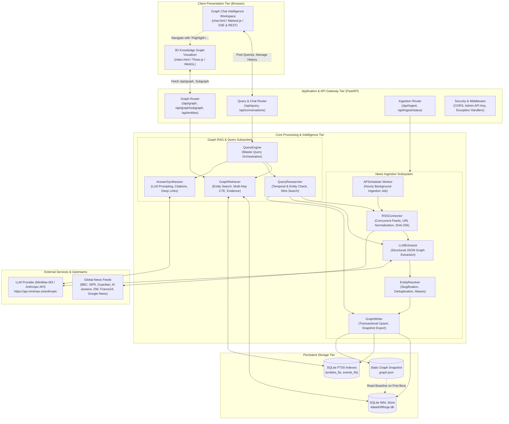

# DriftForge — High-Level Design (HLD) Document
**System Architecture & Technical Specification**
*Version: 2.0.0 | Date: October 2026 | Document Status: Approved*

---

## 1. Executive Summary & Objectives

### 1.1 Overview
**DriftForge** is a production-grade, persistent, continuously updated, evidence-backed news intelligence platform. The platform ingests news from global syndicated news wires (BBC, NPR, The Guardian, Al Jazeera, Deutsche Welle, France 24), extracts entities, events, relationships, and claims using Large Language Models (LLMs), stores the resulting property graph in an ACID-compliant SQLite store with FTS5 search, and delivers intelligence to users through two synchronized frontends:
1. **Interactive 3D Knowledge Graph (`index.html`)**: A Three.js / WebGL force-directed graph visualization rendering community structures, high-degree entities, and multi-hop relationships.
2. **Graph Chat Workspace (`chat.html`)**: A conversational intelligence interface providing evidence-grounded synthesis with live citations, on-demand breaking news wire research, and deep links into the 3D graph visualizer.

### 1.2 Core Business & Technical Objectives
- **Persistent Knowledge Retention**: Move beyond ephemeral single-run scrapers by preserving accumulated historical knowledge across runs without state loss.
- **Evidence-Grounded RAG (Graph RAG)**: Prevent hallucination by anchoring LLM responses in verified graph topology, recorded events, and raw article claims with publisher attribution.
- **Real-Time & On-Demand News Discovery**: Combine autonomous background news ingestion (via APScheduler) with reactive, query-triggered wire search for breaking, uncovered events.
- **Dual Visual & Conversational Exploration**: Allow analysts to fluidly pivot between chatting with the knowledge base and visually traversing connected nodes in 3D.
- **Resource & Operational Efficiency**: Run on lightweight infrastructure (local server or small VM) without requiring heavy external graph database dependencies (e.g., Neo4j), using optimized SQLite with Write-Ahead Logging (`WAL`).

---

## 2. High-Level System Architecture

The following diagram illustrates the high-level architecture of DriftForge, spanning client interfaces, the FastAPI application gateway, core analytical engines, the persistent knowledge store, and external providers.



---

## 3. Subsystem Decomposition & Architectural Principles

### 3.1 Architectural Principles
1. **Separation of Concerns (SoC)**: Ingestion, graph persistence, query retrieval, and answer synthesis are strictly isolated into modular components with explicit contracts.
2. **Deterministic-First Extraction & Identity**: Identity resolution employs deterministic URL normalization and slugification before falling back to fuzzy entity alias matching, preventing identity drift.
3. **Evidence Immutability & Traceability**: Every extracted relationship and claim maintains foreign-key lineage back to its originating news article URL, published timestamp, and publisher.
4. **Idempotency & Safe Deduplication**: All ingestion stages (article storage, entity creation, relationship linking) operate idempotently using primary key hashing, unique indexes, and SQLite `ON CONFLICT` clauses.
5. **Zero-Lock Concurrency**: High-concurrency reads from web visualizers and chat users are supported alongside active background write transactions via SQLite Write-Ahead Logging (`PRAGMA journal_mode = WAL;`).

---

### 3.2 Presentation Tier
- **3D Knowledge Graph (`index.html`)**:
  - Leverages **Three.js** and WebGL force-directed layout algorithms.
  - Implements **quadratic node scaling**: node volume scales with connectivity degree ($deg^2 + 4$) to visually amplify central geopolitical actors.
  - Features real-time community detection (label propagation) and link sentiment styling.
  - Supports deep linking: URL parameters such as `?highlight=entity-a,entity-b` trigger programmatic camera targeting, background node dimming, and focused subgraph inspection.
- **Graph Chat Workspace (`chat.html`)**:
  - Purpose-built intelligence analyst chat interface matching the DriftForge dark aesthetic.
  - Maintains conversation threads persistently via `/api/conversations`.
  - Parses streaming/REST markdown using **Marked.js**.
  - Renders explicit **Verified Source Badges** with direct links to publisher articles.
  - Features an **Explore in 3D Graph** CTA button linking directly into the 3D visualization with pre-populated highlight coordinates.

---

### 3.3 Application Gateway Tier (FastAPI)
- **FastAPI Core (`server.app`)**:
  - Implements asynchronous ASGI lifespan handlers (`@asynccontextmanager`) ensuring database schema migrations and the background scheduler initialize cleanly on startup and gracefully terminate on shutdown.
  - Exposes RESTful endpoints grouped into logical routers (`/api/graph`, `/api/query`, `/api/ingest`).
  - Implements strict Pydantic V2 schema validation and automated OpenAPI documentation (`/docs`).
  - Protects administrative ingestion operations using header-based API key authentication (`X-API-Key`).

---

### 3.4 Ingestion & Transformation Subsystem
- **Feed Harvester (`server.ingestion.sources.RSSConnector`)**:
  - Concurrently queries RSS/Atom feeds across 6+ international news sources using a `ThreadPoolExecutor`.
  - Implements thread-level error isolation: individual feed timeouts or DNS failures do not degrade remaining feeds.
  - Cleans raw article links by removing marketing and tracking parameters (`utm_*`, `fbclid`, `gclid`).
- **LLM Knowledge Extractor (`server.ingestion.extractor.LLMExtractor`)**:
  - Dispatches consolidated article batches to the LLM with structured prompt constraints.
  - Extracts four primary primitives: **Entities**, **Events**, **Directed Relationships**, and **Attributed Claims**.
  - Enforces strict JSON schema output with defensive markdown code block sanitization.
- **Identity & Entity Resolver (`server.ingestion.resolver.EntityResolver`)**:
  - Converts names into clean ASCII slugs (e.g., `"Saudi Arabia"` $\rightarrow$ `"saudi-arabia"`).
  - Performs canonical entity lookup and multi-alias resolution via SQLite FTS5 before assigning new IDs.
- **Graph Writer (`server.ingestion.writer.GraphWriter`)**:
  - Executes multi-table transactional upserts (`articles`, `entities`, `events`, `relationships`, `claims`).
  - Regenerates the static `graph.json` snapshot so static visualizer clients remain immediately synchronized.
- **Scheduler (`server.scheduler`)**:
  - Uses `APScheduler.BackgroundScheduler` configured for periodic hourly execution.
  - Employs a non-blocking `threading.Lock` to guarantee overlapping runs are safely discarded if an ingestion cycle takes longer than scheduled.

---

### 3.5 Graph RAG & Query Intelligence Subsystem
- **Master Query Engine (`server.query.engine.QueryEngine`)**:
  - Orchestrates user message receipt, session state tracking, context retrieval, wire research, and response formulation.
- **Hybrid Graph Retriever (`server.query.retriever.GraphRetriever`)**:
  - Extracts candidate entities from query text using n-gram phrase matching (3-gram down to 1-gram) filtered against stop words.
  - Executes recursive Common Table Expressions (CTE) on SQLite to traverse multi-hop neighborhoods ($k=1$ or $k=2$) around matched entities.
  - Fetches associated claims, recorded events, and supporting source articles.
- **Query-Triggered Wire Researcher (`server.query.researcher.QueryResearcher`)**:
  - Evaluates whether a query requires fresh news wire research (e.g., presence of temporal indicators like "today", "breaking", or when local graph entities are missing).
  - Searches live news wires via Google News RSS search endpoints, fetches new articles, executes LLM extraction on the fly, and merges new nodes into the live graph before synthesizing the answer.
- **Evidence Synthesizer (`server.query.synthesizer.AnswerSynthesizer`)**:
  - Formulates an evidence-grounded briefing referencing verified claims, events, and relationships.
  - Extracts an `explore_graph` metadata block containing the precise entity and event IDs discussed, returning them to the frontend to drive the "Explore in 3D Graph" action.

---

### 3.6 Storage & Persistence Subsystem (SQLite + FTS5)
- **SQLite Engine (`data/driftforge.db`)**:
  - Configured with `PRAGMA journal_mode = WAL;` (Write-Ahead Logging) for concurrent reads while writes take place.
  - Enforces relational foreign keys (`PRAGMA foreign_keys = ON;`) with cascading deletions on article and conversation removal.
  - Uses `PRAGMA synchronous = NORMAL;` for high-throughput disk flushes without sacrificing durability.
- **Full-Text Search (FTS5)**:
  - Virtual tables `entities_fts` and `events_fts` index names, aliases, descriptions, and event summaries.
  - Enables sub-millisecond prefix and phrase queries (`MATCH '"saudi"*'`).

---

## 4. Entity-Relationship (ER) Data Model

```mermaid
erDiagram
    ARTICLES ||--o{ CLAIMS : "sources"
    ARTICLES ||--o{ RELATIONSHIPS : "evidenced_by"
    ENTITIES ||--o{ RELATIONSHIPS : "as_source"
    ENTITIES ||--o{ RELATIONSHIPS : "as_target"
    ENTITIES ||--o{ CLAIMS : "as_subject"