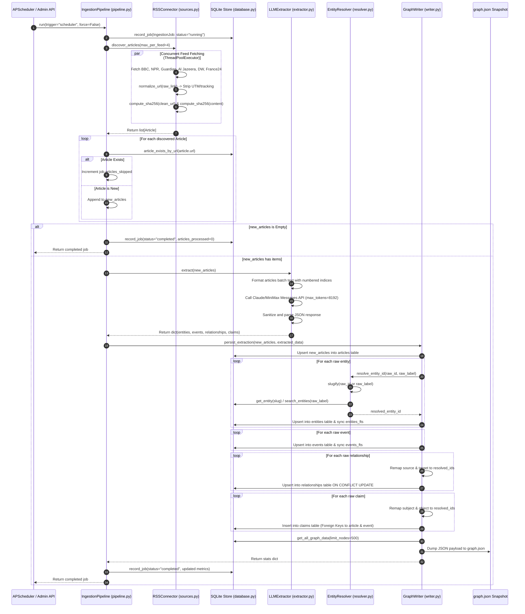
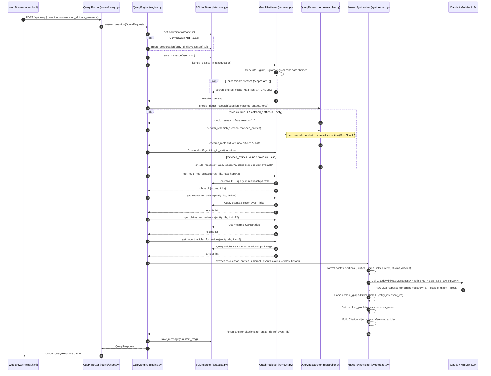
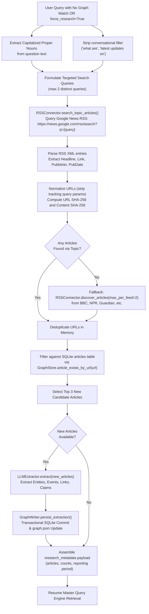
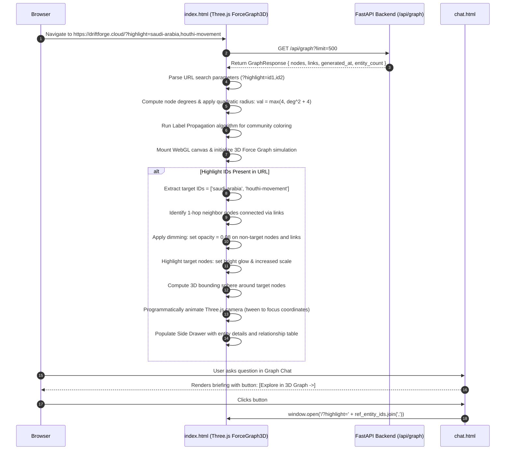

# DriftForge — Low-Level Design (LLD) Document
**Detailed Component, Function, Class & Data Flow Specifications**
*Version: 2.0.0 | Date: October 2026 | Document Status: Approved*

---

## 1. Introduction & Scope

This document provides the Low-Level Design (LLD) for the **DriftForge News Intelligence Platform**. It is the implementation-level counterpart to the High-Level Design (HLD). It details:
- **System-Wide & Intra-Component Data Flow Diagrams** covering the complete lifecycle of news ingestion, entity resolution, graph retrieval, query-triggered research, and response synthesis.
- **Exhaustive Module Catalog** detailing every module in the project codebase.
- **Detailed Function & Method Specifications** including exact parameter signatures, return types, step-by-step algorithmic logic, error handling, database operations, and external API calls.

---

## 2. System Data Flow Diagrams

### 2.1 Autonomous Background Ingestion Flow
This flow is executed periodically (hourly) by `server.scheduler` or triggered manually via `POST /api/ingest`.



---

### 2.2 Conversational Graph RAG Query Flow
This flow processes user inquiries submitted via `POST /api/query` from the Graph Chat workspace (`chat.html`).



---

### 2.3 Query-Triggered On-Demand News Research Flow
When a user asks about an emerging topic absent from the graph or explicitly clicks "Force Live Research", this flow executes synchronously within the query lifecycle.



---

### 2.4 3D Force Graph Visualizer & Deep Link Navigation Flow
Illustrates how the frontend visualizer initializes and responds to highlight deep links generated by the chat workspace.



---

## 3. Exhaustive Module Specifications

---

### 3.1 Module: `server.config`
- **File**: `server/config.py`
- **Architectural Layer**: Infrastructure / Configuration
- **Responsibilities**: Centralized environment variable loading, default values management, directory resolution, and runtime settings configuration using Pydantic V2.

#### 3.1.1 Class: `Settings`
Inherits from `pydantic.BaseModel`.

```python
class Settings(BaseModel):
    app_name: str = "DriftForge News Intelligence Platform"
    version: str = "2.0.0"
    host: str = Field(default_factory=lambda: os.environ.get("HOST", "0.0.0.0"))
    port: int = Field(default_factory=lambda: int(os.environ.get("PORT", "8080")))
    data_dir: Path = DATA_DIR
    db_path: Path = Field(default_factory=lambda: Path(os.environ.get("DATABASE_PATH", str(DATA_DIR / "driftforge.db"))))
    anthropic_base_url: str = Field(default_factory=lambda: os.environ.get("ANTHROPIC_BASE_URL", "https://api.minimax.io/anthropic"))
    anthropic_api_key: str = Field(default_factory=lambda: os.environ.get("ANTHROPIC_API_KEY") or os.environ.get("MINIMAX_API_KEY", ""))
    llm_model: str = Field(default_factory=lambda: os.environ.get("LLM_MODEL", "MiniMax-M3"))
    llm_timeout: int = Field(default_factory=lambda: int(os.environ.get("LLM_TIMEOUT", "60")))
    admin_api_key: str = Field(default_factory=lambda: os.environ.get("ADMIN_API_KEY", "driftforge-admin-secret"))
    cors_origins: list[str] = ["*"]
    rss_feeds: list[str] = [
        "http://feeds.bbci.co.uk/news/world/rss.xml",
        "https://feeds.npr.org/1001/rss.xml",
        "https://www.theguardian.com/world/rss",
        "https://www.aljazeera.com/xml/rss/all.xml",
        "https://rss.dw.com/rdf/rss-en-world",
        "https://www.france24.com/en/rss",
    ]
    max_articles_per_feed: int = Field(default_factory=lambda: int(os.environ.get("MAX_ARTICLES_PER_FEED", "4")))
    ingestion_schedule_hours: int = Field(default_factory=lambda: int(os.environ.get("INGESTION_SCHEDULE_HOURS", "1")))
    scheduler_enabled: bool = Field(default_factory=lambda: os.environ.get("SCHEDULER_ENABLED", "true").lower() in ("true", "1", "yes"))
    timezone: str = Field(default_factory=lambda: os.environ.get("TIMEZONE", "UTC"))
    research_max_subqueries: int = 3
    research_max_articles: int = 12
    research_timeout_seconds: int = 45
```

- **Global Instance**: `settings = Settings()`
- **Initialization Behavior**: Automatically runs `dotenv.load_dotenv()` and verifies the presence of the `data/` directory (`DATA_DIR.mkdir(parents=True, exist_ok=True)`).

---

### 3.2 Module: `server.models`
- **File**: `server/models.py`
- **Architectural Layer**: Domain / Contracts
- **Responsibilities**: Defines all core business entities and REST request/response data contracts.

#### 3.2.1 Utility Functions
- **`utc_now_iso() -> str`**:
  - *Returns*: Current UTC timestamp in ISO-8601 format string (e.g., `"2026-10-12T01:45:00.123456+00:00"`).

#### 3.2.2 Domain Models
- **`EntityType(str, Enum)`**:
  - Permitted values: `PERSON`, `ORGANISATION`, `COUNTRY`, `LOCATION`, `GOVERNMENT`, `EVENT`, `CONCEPT`, `ARMED_GROUP`, `INFRASTRUCTURE`.
- **`Entity(BaseModel)`**:
  - `id: str`: Canonical slug identifier (e.g., `"saudi-arabia"`).
  - `entity_type: str`: Entity category conforming to `EntityType`.
  - `canonical_name: str`: Human-readable display label.
  - `description: Optional[str]`: Contextual background extracted from reporting.
  - `aliases: list[str]`: Alternative identifiers and names.
  - `external_ids: dict[str, str]`: Optional cross-references (Wikidata, OpenSanctions).
  - `first_observed_at: str`: ISO-8601 timestamp of first recorded mention.
  - `updated_at: str`: ISO-8601 timestamp of most recent update.
  - `metadata: dict[str, Any]`: Unstructured key-value store for extensible attributes.
- **`Event(BaseModel)`**:
  - `id: str`: Unique slug or UUID identifier.
  - `event_type: str`: Category (`military_action`, `diplomatic_meeting`, `agreement`, etc.).
  - `summary: str`: Terse synopsis of the incident.
  - `event_time: Optional[str]`: Stated date/time.
  - `event_time_precision: str`: Precision specifier (`exact`, `day`, `week`, `approximate`).
  - `location: Optional[str]`: Geographic venue.
  - `status: str`: Verification status (`reported`, `confirmed`, `denied`, `retracted`).
  - `confidence: float`: Numerical certainty score (0.0 to 1.0).
  - `first_observed_at: str`, `updated_at: str`, `metadata: dict[str, Any]`.
- **`Article(BaseModel)`**:
  - `id: str`: Unique UUID.
  - `url: str`: Normalized canonical URL.
  - `url_hash: str`: SHA-256 hexadecimal hash of `url`.
  - `publisher: Optional[str]`: Publishing outlet (e.g., `"BBC News"`).
  - `headline: Optional[str]`: Article title.
  - `summary: Optional[str]`: Lead summary or synopsis.
  - `content_excerpt: Optional[str]`: Cleaned text excerpt (up to 500 characters).
  - `content_hash: Optional[str]`: SHA-256 hash of headline + summary.
  - `author: Optional[str]`: Byline attribution.
  - `language: str = "en"`: ISO language code.
  - `published_at: Optional[str]`: Original publication time string.
  - `ingested_at: str`: Pipeline ingestion timestamp.
  - `feed_source: Optional[str]`: Source RSS feed URL or query origin.
  - `extraction_status: str`: Status flag (`pending`, `extracted`, `failed`, `skipped`).
  - `metadata: dict[str, Any]`.
- **`Relationship(BaseModel)`**:
  - `id: str`: Deterministic ID (`"{source}_{type}_{target}"`).
  - `source_id: str`: Origin entity ID.
  - `target_id: str`: Destination entity ID.
  - `relationship_type: str`: Directed predicate (`opposes`, `supports`, `causes`, etc.).
  - `description: Optional[str]`: Semantic description of relationship context.
  - `source_article_id: Optional[str]`: Foreign key reference to supporting `Article.id`.
  - `first_observed_at: str`, `updated_at: str`, `metadata: dict[str, Any]`.
- **`Claim(BaseModel)`**:
  - `id: str`: UUID string.
  - `claim_text: str`: Specific quote or assertion.
  - `subject_entity_id: Optional[str]`, `predicate: Optional[str]`, `object_entity_id: Optional[str]`.
  - `source_article_id: str`: Mandatory foreign key to `Article.id`.
  - `attribution: Optional[str]`: Stated speaker or agency (e.g., `"Spokesman"`).
  - `claim_type: str`: Categorization (`official_claim`, `media_report`, `corroborated`).
  - `confidence: float = 0.8`, `event_id: Optional[str]`, `observed_at: str`, `metadata: dict[str, Any]`.
- **`Conversation(BaseModel)`**:
  - `id: str`: UUID session identifier.
  - `title: Optional[str]`: Conversation title.
  - `created_at: str`, `updated_at: str`.
- **`Message(BaseModel)`**:
  - `id: str`: UUID identifier.
  - `conversation_id: str`: Foreign key to `Conversation.id`.
  - `role: str`: Participant role (`user` or `assistant`).
  - `content: str`: Markdown message body.
  - `citations: list[dict[str, Any]]`: Articles cited in response.
  - `entity_ids: list[str]`: Entities referenced in answer.
  - `event_ids: list[str]`: Events referenced in answer.
  - `research_metadata: dict[str, Any]`: Wire research diagnostics.
  - `created_at: str`.
- **`IngestionJob(BaseModel)`**:
  - `id: str`: UUID identifier.
  - `job_type: str`: Trigger type (`scheduled`, `manual`, `query_triggered`).
  - `status: str`: State (`running`, `completed`, `failed`, `cancelled`).
  - `started_at: str`, `completed_at: Optional[str]`, `trigger: Optional[str]`.
  - Metric counters: `articles_discovered`, `articles_processed`, `articles_skipped`, `articles_failed`, `entities_created`, `entities_updated`, `events_created`, `relationships_created`.
  - `error_details: Optional[str]`, `metadata: dict[str, Any]`.

#### 3.2.3 API Contract Models
- **`Citation(BaseModel)`**: `id`, `headline`, `publisher`, `url`, `published_at`, `summary`.
- **`QueryRequest(BaseModel)`**: `question: str`, `conversation_id: Optional[str]`, `timezone: Optional[str] = "UTC"`, `force_research: bool = False`.
- **`QueryResponse(BaseModel)`**: `answer: str`, `citations: list[Citation]`, `entity_ids: list[str]`, `event_ids: list[str]`, `research_metadata: dict[str, Any]`, `conversation_id: str`, `message_id: str`.
- **`GraphNode(BaseModel)`**: `id`, `label`, `type`, `description`, `val`, `connection_count`, `first_observed_at`.
- **`GraphLink(BaseModel)`**: `source`, `target`, `type`, `description`.
- **`GraphResponse(BaseModel)`**: `nodes: list[GraphNode]`, `links: list[GraphLink]`, `generated_at: str`, `entity_count: int`, `relationship_count: int`.
- **`IngestRequest(BaseModel)`**: `force: bool = False`, `max_articles_per_feed: Optional[int] = None`.
- **`IngestResponse(BaseModel)`**: `job_id: str`, `status: str`, `message: str`, `stats: dict[str, Any]`.
- **`HealthResponse(BaseModel)`**: `status: str`, `version: str`, `database: str`, `entity_count: int`, `relationship_count: int`, `article_count: int`, `last_ingestion: Optional[str]`.

---

### 3.3 Module: `server.database`
- **File**: `server/database.py`
- **Architectural Layer**: Persistence / Data Access Layer
- **Responsibilities**: SQLite connection pool management (thread-local), schema migration, FTS5 virtual tables maintenance, baseline auto-seeding, and low-level repository operations.

#### 3.3.1 Connection Management Functions
- **`get_db_connection() -> sqlite3.Connection`**:
  - Utilizes `threading.local()` cache to allocate one `sqlite3.Connection` per worker thread.
  - Sets `conn.row_factory = sqlite3.Row` for dict-like column access.
  - Executes critical performance PRAGMAs:
    - `PRAGMA journal_mode = WAL;`: Enables concurrent read operations during write transactions.
    - `PRAGMA foreign_keys = ON;`: Enforces relational referential integrity.
    - `PRAGMA synchronous = NORMAL;`: Optimizes disk sync without corrupting WAL logs.
- **`get_db() -> Generator[sqlite3.Connection, None, None]`**:
  - Context manager wrapping `get_db_connection()`.
  - Yields connection within a `try/except` block; automatically invokes `conn.rollback()` on uncaught exceptions.

#### 3.3.2 Initialization & Seeding Functions
- **`init_db(db_path: Optional[Path] = None) -> None`**:
  - Ensures parent folder of database file exists.
  - Executes `SCHEMA_SQL` creating tables (`entities`, `events`, `articles`, `claims`, `relationships`, `entity_event_links`, `conversations`, `messages`, `ingestion_jobs`) and B-Tree indexes.
  - Executes `FTS_SQL` creating full-text search virtual tables `entities_fts` and `events_fts`.
  - Calls `seed_from_graph_json_if_empty()`.
- **`seed_from_graph_json_if_empty() -> None`**:
  - Queries `SELECT COUNT(*) FROM entities`. If count $> 0$, aborts immediately.
  - If empty, inspects root `graph.json`. Parses nodes and links, inserting baseline entities and relationships, and populating `entities_fts`.

#### 3.3.3 Repository Class: `GraphStore`
Static methods encapsulating all database interactions:

1. **`upsert_entity(entity: Entity) -> None`**:
   - Executes `INSERT INTO entities (...) VALUES (...) ON CONFLICT(id) DO UPDATE SET ...` updating attributes and `updated_at`.
   - Synchronizes `entities_fts` by deleting existing entry for `entity.id` and inserting updated values.
2. **`get_entity(entity_id: str) -> Optional[dict]`**:
   - Performs `SELECT * FROM entities WHERE id = ?`. Parses JSON strings (`aliases`, `external_ids`, `metadata`).
3. **`search_entities(query: str, limit: int = 20) -> list[dict]`**:
   - Tries FTS5 search first: prepares sanitized match expression `f'"{clean_query}"*'` and queries `entities JOIN entities_fts ON entities.id = entities_fts.id WHERE entities_fts MATCH ?`.
   - If FTS fails or yields 0 rows, falls back to `SELECT * FROM entities WHERE id LIKE ? OR canonical_name LIKE ? OR aliases LIKE ?`.
4. **`upsert_event(event: Event) -> None`**:
   - Performs `INSERT INTO events (...) VALUES (...) ON CONFLICT(id) DO UPDATE SET ...`.
   - Synchronizes `events_fts`.
5. **`get_event(event_id: str) -> Optional[dict]`**:
   - Selects event by ID; deserializes metadata JSON.
6. **`upsert_relationship(rel: Relationship) -> None`**:
   - Executes `INSERT INTO relationships (...) ON CONFLICT(source_id, target_id, relationship_type) DO UPDATE SET ...`.
7. **`get_relationships_for_entity(entity_id: str) -> list[dict]`**:
   - Joins `relationships` with `entities` on `source_id` and `target_id` to include canonical names and entity types for both endpoints. Filters by `WHERE source_id = ? OR target_id = ?`.
8. **`upsert_article(article: Article) -> bool`**:
   - Checks if article exists via `SELECT id FROM articles WHERE url = ?`.
   - If found, returns `False` (already known).
   - If absent, inserts into `articles` and returns `True` (newly inserted).
9. **`get_article(article_id: str) -> Optional[dict]`**:
   - Selects article by ID.
10. **`article_exists_by_url(url: str) -> bool`**:
    - Runs fast index probe `SELECT 1 FROM articles WHERE url = ?`.
11. **`get_all_graph_data(limit_nodes: int = 500) -> dict`**:
    - Computes degrees for all nodes using union aggregation:
      ```sql
      SELECT entity_id, COUNT(*) as deg FROM (
          SELECT source_id as entity_id FROM relationships
          UNION ALL
          SELECT target_id as entity_id FROM relationships
      ) GROUP BY entity_id
      ```
    - Sorts entities by degree descending and caps at `limit_nodes`.
    - Formats node radii: `val = max(4, deg**2 + 4)`.
    - Gathers all links whose source and target are both in the active node set.
    - Returns `{ "nodes": nodes, "links": links, "generated_at": ..., "entity_count": ..., "relationship_count": ... }`.
12. **`get_subgraph(entity_ids: list[str], max_hops: int = 1) -> dict`**:
    - Traverses graph using a Recursive Common Table Expression:
      ```sql
      WITH RECURSIVE neighborhood(node_id, depth) AS (
          SELECT id, 0 FROM entities WHERE id IN (?, ?)
          UNION
          SELECT CASE WHEN r.source_id = n.node_id THEN r.target_id ELSE r.source_id END,
                 n.depth + 1
          FROM relationships r
          JOIN neighborhood n ON (r.source_id = n.node_id OR r.target_id = n.node_id)
          WHERE n.depth < ?
      )
      SELECT DISTINCT node_id FROM neighborhood;
      ```
    - Fetches entities and relationships where both endpoints belong to the discovered neighborhood.
13. **`create_conversation(conv_id: str, title: str = "New Conversation") -> Conversation`**:
    - Inserts a record into `conversations`.
14. **`get_conversation(conv_id: str) -> Optional[dict]`**:
    - Retrieves conversation metadata and joins chronological `messages` (`ORDER BY created_at ASC`), parsing citations, entity_ids, and research_metadata.
15. **`list_conversations(limit: int = 50) -> list[dict]`**:
    - Retrieves active conversations ordered by `updated_at DESC`.
16. **`save_message(message: Message) -> None`**:
    - Inserts message record and touches parent conversation's `updated_at`.
17. **`record_job(job: IngestionJob) -> None`**:
    - Inserts or updates job records in `ingestion_jobs` via `ON CONFLICT(id) DO UPDATE`.
18. **`list_jobs(limit: int = 20) -> list[dict]`**:
    - Returns recent background and manual ingestion job runs ordered by `started_at DESC`.

---

### 3.4 Module: `server.scheduler`
- **File**: `server/scheduler.py`
- **Architectural Layer**: Background Task Scheduling
- **Responsibilities**: Manages non-overlapping autonomous background news harvesting jobs.

#### 3.4.1 Functions
- **`run_scheduled_ingestion() -> None`**:
  - Attempts non-blocking acquisition of `_job_lock = threading.Lock()`.
  - If lock acquisition fails: logs message and skips overlapping invocation.
  - If acquired: creates `IngestionPipeline()` instance and runs `pipeline.run(trigger="scheduler", force=False)`.
  - Releases lock in a `finally` block.
- **`start_scheduler() -> Optional[BackgroundScheduler]`**:
  - Validates `settings.scheduler_enabled`. If disabled, returns `None`.
  - Instantiates `BackgroundScheduler(daemon=True)`.
  - Registers `run_scheduled_ingestion` using `IntervalTrigger(hours=settings.ingestion_schedule_hours)` with job ID `"news_ingestion_hourly"`.
  - Calls `scheduler.start()` and stores reference in `_scheduler`.
- **`shutdown_scheduler() -> None`**:
  - If `_scheduler` is running, executes `_scheduler.shutdown(wait=False)` and resets reference to `None`.

---

### 3.5 Module: `server.ingestion.sources`
- **File**: `server/ingestion/sources.py`
- **Architectural Layer**: News Harvesting & Normalization
- **Responsibilities**: URL sanitization, cryptographic hashing, publisher attribution detection, and concurrent RSS parsing.

#### 3.5.1 Standalone Utility Functions
- **`normalize_url(url: str) -> str`**:
  - Parses URL with `urllib.parse.urlparse`.
  - Strips tracking query parameters (`utm_source`, `utm_medium`, `utm_campaign`, `utm_term`, `utm_content`, `fbclid`, `gclid`, `ref`, `ref_src`, `source`).
  - Converts scheme and hostname to lowercase; strips URL fragment (`#`).
  - Reassembles and returns cleaned URL string.
- **`compute_sha256(text: str) -> str`**:
  - Encodes string as UTF-8 and returns SHA-256 hexadecimal digest (`hashlib.sha256(text.encode("utf-8")).hexdigest()`).
- **`detect_publisher(url: str, default: Optional[str] = None) -> str`**:
  - Inspects netloc domain name. Matches against known patterns:
    - `"bbc."` or `"bbci."` $\rightarrow$ `"BBC News"`
    - `"npr."` $\rightarrow$ `"NPR"`
    - `"theguardian."` $\rightarrow$ `"The Guardian"`
    - `"aljazeera."` $\rightarrow$ `"Al Jazeera"`
    - `"dw."` $\rightarrow$ `"Deutsche Welle"`
    - `"france24."` $\rightarrow$ `"France 24"`
  - Falls back to `default` or the raw domain.

#### 3.5.2 Class: `RSSConnector`
- **`__init__(feeds: Optional[list[str]] = None)`**:
  - Sets `self.feeds = feeds or settings.rss_feeds`.
- **`_fetch_single_feed(feed_url: str, max_per_feed: int) -> list[Article]`**:
  - Calls `feedparser.parse(feed_url)`.
  - Detects publisher name via `detect_publisher`.
  - Iterates through entries up to `max_per_feed`.
  - For each valid entry: normalizes URL, calculates `url_hash`, extracts publication date, builds `content_hash` from title + summary, and constructs an `Article` object with `extraction_status="pending"`.
  - Traps exceptions per feed to isolate failures.
- **`discover_articles(max_per_feed: int = 4) -> list[Article]`**:
  - Spawns a `concurrent.futures.ThreadPoolExecutor(max_workers=min(len(self.feeds), 6))`.
  - Submits `_fetch_single_feed` for every configured feed URL.
  - Aggregates results across all completed futures.
- **`search_topic_articles(query: str, max_articles: int = 6) -> list[Article]`**:
  - URL-encodes query string and targets Google News RSS endpoint:
    `f"https://news.google.com/rss/search?q={encoded_q}&hl=en-US&gl=US&ceid=US:en"`.
  - Parses XML with `feedparser.parse()`.
  - Cleans headline titles (strips `" - {publisher}"` suffixes).
  - Returns constructed `Article` instances tagged with `feed_source=f"topic_search:{query}"`.

---

### 3.6 Module: `server.ingestion.extractor`
- **File**: `server/ingestion/extractor.py`
- **Architectural Layer**: Knowledge Graph Extraction
- **Responsibilities**: Formats news article corpora, constructs structured prompts, interfaces with Anthropic/MiniMax API, and validates output graph primitives.

#### 3.6.1 Constants
- **`EXTRACTION_SYSTEM_PROMPT`**:
  - Directs model to act as a geopolitical intelligence analyst.
  - Enforces permitted entity types (`person`, `organisation`, `country`, `location`, `government`, `armed_group`, `concept`).
  - Enforces permitted event types (`military_action`, `diplomatic_meeting`, `agreement`, `statement`, `sanctions`, `incident`, `economic_action`, `legal_action`).
  - Enforces permitted directed relationship types (`causes`, `caused_by`, `involves`, `opposes`, `supports`, `allies_with`, `threatens`, `located_in`, `responds_to`, `impacts`, `negotiates_with`, `accuses`, `sanctions`, `participated_in`).
  - Mandates lowercase hyphen-separated IDs and 1-based `article_index` references.

#### 3.6.2 Class: `LLMExtractor`
- **`__init__()`**:
  - Initializes `Anthropic` client configured with `settings.anthropic_base_url`, `settings.anthropic_api_key`, and `settings.llm_timeout`.
  - Sets `self.model = settings.llm_model`.
- **`extract(articles: list[Article]) -> dict[str, Any]`**:
  - If `articles` is empty: returns empty dict `{"entities": [], "events": [], "relationships": [], "claims": []}`.
  - Formats articles batch into numbered sections containing Publisher, PubDate, Title, Summary, and URL.
  - Invokes `self.client.messages.create()` with `max_tokens=8192` and system prompt.
  - Strips markdown code blocks (```` ```json ```` / ```` ``` ````).
  - Deserializes JSON string into dictionary and returns structured output.
  - Logs and raises on JSON or HTTP failure.

---

### 3.7 Module: `server.ingestion.resolver`
- **File**: `server/ingestion/resolver.py`
- **Architectural Layer**: Identity & Entity Resolution
- **Responsibilities**: Normalizes raw textual strings into slugs, resolves entities against the persistent graph, and deduplicates aliases.

#### 3.7.1 Standalone Functions
- **`slugify(text: str) -> str`**:
  - Applies Unicode NFKD decomposition and strips non-ASCII accents.
  - Converts text to lowercase and strips all characters except `\w`, `\s`, `-`.
  - Collapses consecutive whitespace and dashes into a single hyphen.

#### 3.7.2 Class: `EntityResolver`
- **`resolve_entity_id(raw_id: str, raw_label: str) -> str`**:
  - Computes `normalized_id = slugify(raw_id or raw_label)`. Falls back to `"unknown-entity"` if empty.
  - Step 1 (Exact Match): Calls `GraphStore.get_entity(normalized_id)`. If present, returns `normalized_id`.
  - Step 2 (FTS/Alias Match): Calls `GraphStore.search_entities(raw_label, limit=5)`.
    - Compares `match["canonical_name"].strip().lower() == raw_label.strip().lower()`. If match, returns `match["id"]`.
    - Iterates `match.get("aliases", [])`. If any alias matches `raw_label.strip().lower()`, returns `match["id"]`.
  - Step 3 (Novel Entity): Returns `normalized_id`.
- **`merge_aliases(existing_aliases: list[str], new_alias: Optional[str]) -> list[str]`**:
  - Trims `new_alias`. If non-empty and not already present in `existing_aliases`, appends it and returns the updated list.

---

### 3.8 Module: `server.ingestion.writer`
- **File**: `server/ingestion/writer.py`
- **Architectural Layer**: Transactional Graph Persistence
- **Responsibilities**: Transactionally persists articles, entities, events, relationships, and claims to SQLite, and exports static graph snapshots.

#### 3.8.1 Class: `GraphWriter`
- **`persist_extraction(articles: list[Article], extracted_data: dict[str, Any]) -> dict[str, int]`**:
  - Initializes metrics dictionary `stats`.
  - Maps 1-based index to `Article` objects (`article_map`).
  - Persists all articles via `GraphStore.upsert_article(a)`.
  - Resolves entities via `EntityResolver.resolve_entity_id()`, merging aliases if entity previously existed, and saves via `GraphStore.upsert_entity()`. Maintains an in-memory `id_remap` table mapping raw IDs to resolved IDs.
  - Inserts events via `GraphStore.upsert_event()`.
  - Rewrites relationship `source` and `target` using `id_remap`. Discards self-referencing loops ($s = t$). Inserts via `GraphStore.upsert_relationship()`.
  - Rewrites claims with resolved entity IDs and inserts into `claims` table.
  - Calls `export_graph_snapshot()`.
  - Returns `stats`.
- **`export_graph_snapshot() -> None`**:
  - Calls `GraphStore.get_all_graph_data(limit_nodes=500)`.
  - Writes formatted JSON to `settings.data_dir.parent / "graph.json"` with indentation of 2 spaces.

---

### 3.9 Module: `server.ingestion.pipeline`
- **File**: `server/ingestion/pipeline.py`
- **Architectural Layer**: Pipeline Orchestration
- **Responsibilities**: Coordinates the complete news ingestion lifecycle.

#### 3.9.1 Class: `IngestionPipeline`
- **`__init__()`**:
  - Instantiates `self.sources = RSSConnector()`, `self.extractor = LLMExtractor()`, and `self.writer = GraphWriter()`.
- **`run(trigger: str = "scheduler", max_per_feed: Optional[int] = None, force: bool = False) -> IngestionJob`**:
  - Allocates UUID `job_id` and logs job record with status `"running"`.
  - Calls `self.sources.discover_articles()`.
  - Filters out existing articles unless `force=True`.
  - If no new articles: marks job `"completed"` and exits early.
  - If new articles: invokes `self.extractor.extract()`, followed by `self.writer.persist_extraction()`.
  - Updates `IngestionJob` record with final counts, marks status `"completed"`, and records `completed_at`.
  - On error: records failure details in DB and re-raises exception.

---

### 3.10 Module: `server.query.retriever`
- **File**: `server/query/retriever.py`
- **Architectural Layer**: Graph Information Retrieval
- **Responsibilities**: Extracts candidate entity phrases from user text and fetches multi-hop subgraphs, events, claims, and articles.

#### 3.10.1 Class: `GraphRetriever`
- **`identify_entities_in_text(text: str) -> list[dict]`**:
  - Splits text into tokens, stripping punctuation.
  - Builds candidate phrases of lengths 3, 2, and 1, skipping phrases composed purely of stop words (`"the"`, `"what"`, `"updates"`, etc.).
  - Deduplicates phrases in order of appearance and caps candidate list at 15 phrases.
  - Queries `GraphStore.search_entities(phrase, limit=3)` for each phrase.
  - Collects and returns unique candidate entity dicts indexed by `id`.
- **`get_multi_hop_context(entity_ids: list[str], max_hops: int = 2) -> dict`**:
  - Calls `GraphStore.get_subgraph(entity_ids, max_hops=max_hops)`.
- **`get_events_for_entities(entity_ids: list[str], limit: int = 10) -> list[dict]`**:
  - Queries `events` table joined with `entity_event_links` matching `entity_id IN (...)` or summary text pattern. Returns parsed event dicts.
- **`get_claims_and_evidence(entity_ids: list[str], limit: int = 15) -> list[dict]`**:
  - Queries `claims` joined with `articles` where `subject_entity_id IN (...) OR object_entity_id IN (...)` ordered by `observed_at DESC`.
- **`get_recent_articles_for_entities(entity_ids: list[str], limit: int = 10) -> list[dict]`**:
  - Queries distinct `articles` referenced by claims or relationships involving the target entities.

---

### 3.11 Module: `server.query.researcher`
- **File**: `server/query/researcher.py`
- **Architectural Layer**: Reactive News Wire Discovery
- **Responsibilities**: Determines whether queries necessitate external wire searches and dynamically enriches the knowledge graph.

#### 3.11.1 Constants
- **`TEMPORAL_KEYWORDS`**:
  `{"today", "yesterday", "latest", "breaking", "update", "updates", "recent", "current", "now", "this week", "last night", "new", "ongoing"}`.

#### 3.11.2 Class: `QueryResearcher`
- **`__init__()`**:
  - Initializes `self.sources = RSSConnector()`, `self.extractor = LLMExtractor()`, and `self.writer = GraphWriter()`.
- **`should_trigger_research(question: str, matched_entities: list[dict], force: bool = False) -> tuple[bool, str]`**:
  - If `force == True`: returns `(True, "User requested forced live news research.")`.
  - If `matched_entities` is non-empty: returns `(False, "Existing knowledge graph context is available.")`.
  - If `matched_entities` is empty: returns `(True, "No matching entities found in local graph; discovering from news wire.")`.
- **`perform_research(question: str, matched_entities: list[dict]) -> dict[str, Any]`**:
  - Extracts capitalized proper nouns and cleans conversational filler from question to form targeted queries.
  - Queries Google News RSS via `self.sources.search_topic_articles()`.
  - If topic search yields 0 articles, falls back to general RSS feeds via `discover_articles(max_per_feed=2)`.
  - Deduplicates articles by URL and filters out articles already present in SQLite.
  - Selects top 3 new articles and triggers extraction via `self.extractor.extract()`.
  - Persists new graph nodes and relationships via `self.writer.persist_extraction()`.
  - Returns a detailed `research_metadata` payload including articles found, new counts, and reporting period.

---

### 3.12 Module: `server.query.synthesizer`
- **File**: `server/query/synthesizer.py`
- **Architectural Layer**: LLM Evidence Synthesis
- **Responsibilities**: Assembles retrieved graph topology, claims, events, and citations into an LLM prompt and parses the final response.

#### 3.12.1 Constants
- **`SYNTHESIS_SYSTEM_PROMPT`**:
  - Defines the persona of the DriftForge Intelligence Analyst.
  - Requires objective markdown structure (Key Developments, Actor Analysis, Strategic Implications).
  - Mandates inline citations and an `explore_graph` JSON trailer block at the end.

#### 3.12.2 Class: `AnswerSynthesizer`
- **`__init__()`**:
  - Sets up `Anthropic` client with base URL, key, timeout, and model settings.
- **`synthesize(question, entities, subgraph, events, claims, articles, conversation_history) -> tuple[str, list[Citation], list[str], list[str]]`**:
  - Formats five distinct context blocks: Knowledge Graph Entities, Graph Relationships, Recorded Events, Evidence Claims, Supporting Articles.
  - Appends recent conversation history (last 4 messages).
  - Calls `client.messages.create(max_tokens=1536)`.
  - Extracts the ```` ```explore_graph { ... } ``` ```` JSON block via regex. Deserializes `entity_ids` and `event_ids`.
  - Removes the `explore_graph` block from the visible text body.
  - Assembles deduplicated `Citation` instances from the referenced article objects.
  - Returns `(clean_answer, citations, entity_ids, event_ids)`.

---

### 3.13 Module: `server.query.engine`
- **File**: `server/query/engine.py`
- **Architectural Layer**: Query Orchestration
- **Responsibilities**: Master entry point coordinating retrieval, on-demand research, synthesis, and conversation history persistence.

#### 3.13.1 Class: `QueryEngine`
- **`__init__()`**:
  - Instantiates `self.retriever = GraphRetriever()`, `self.researcher = QueryResearcher()`, and `self.synthesizer = AnswerSynthesizer()`.
- **`answer_question(req: QueryRequest) -> QueryResponse`**:
  - Resolves or creates conversation session ID via `GraphStore.create_conversation()`.
  - Saves user query message to database.
  - Identifies candidate entities in question text.
  - Checks if fresh news research is required via `self.researcher.should_trigger_research()`.
  - If research is triggered: performs research, saves new nodes, and re-identifies entities.
  - If still no entities identified: falls back to top 10 highest-degree entities from SQLite.
  - Retrieves multi-hop context (subgraph), events, claims, and articles for the active entity IDs.
  - Synthesizes answer and citations via `self.synthesizer.synthesize()`.
  - Saves assistant response message to SQLite with citations and graph coordinates.
  - Returns fully constructed `QueryResponse`.

---

### 3.14 Module: `server.routes.graph`
- **File**: `server/routes/graph.py`
- **Architectural Layer**: API Gateway / HTTP Routes
- **Responsibilities**: Exposes graph topology, subgraphs, entity details, search, and event queries.

#### 3.14.1 Endpoints
- **`GET /api/graph`** (`get_graph(limit: int = 500)`):
  - Validates `limit` ($10 \le \text{limit} \le 2000$).
  - Invokes `GraphStore.get_all_graph_data(limit_nodes=limit)`.
  - Returns `GraphResponse`.
- **`GET /api/graph/subgraph`** (`get_subgraph(nodes: str, hops: int = 1)`):
  - Splits comma-separated `nodes` query parameter into entity ID list.
  - Raises HTTP 400 if ID list is empty.
  - Calls `GraphStore.get_subgraph(node_ids, max_hops=hops)`.
- **`GET /api/entities/{entity_id}`** (`get_entity_detail(entity_id: str)`):
  - Fetches entity via `GraphStore.get_entity(entity_id)`.
  - Raises HTTP 404 if not found.
  - Fetches relationships via `GraphStore.get_relationships_for_entity(entity_id)`.
  - Returns combined dictionary `{ "entity": entity, "relationships": relationships }`.
- **`GET /api/entities/search`** (`search_entities(q: str, limit: int = 20)`):
  - Queries `GraphStore.search_entities(q, limit=limit)` using FTS5 with LIKE fallback.
- **`GET /api/events/{event_id}`** (`get_event_detail(event_id: str)`):
  - Fetches event via `GraphStore.get_event(event_id)`. Raises HTTP 404 if absent.

---

### 3.15 Module: `server.routes.query`
- **File**: `server/routes/query.py`
- **Architectural Layer**: API Gateway / HTTP Routes
- **Responsibilities**: Exposes conversational endpoints and chat session management.

#### 3.15.1 Endpoints
- **`POST /api/query`** (`execute_query(req: QueryRequest)`):
  - Validates question is non-empty.
  - Calls `_query_engine.answer_question(req)`.
  - Returns `QueryResponse`.
- **`GET /api/conversations`** (`list_conversations(limit: int = 50)`):
  - Returns recent conversation sessions from `GraphStore.list_conversations(limit=limit)`.
- **`POST /api/conversations`** (`create_conversation(req: CreateConversationRequest)`):
  - Generates UUID `conv_id`.
  - Calls `GraphStore.create_conversation(conv_id, title=req.title)`.
  - Returns serialized conversation object.
- **`GET /api/conversations/{conversation_id}`** (`get_conversation_history(conversation_id: str)`):
  - Fetches conversation via `GraphStore.get_conversation(conversation_id)`.
  - Raises HTTP 404 if absent.
  - Returns conversation metadata with ordered message list.

---

### 3.16 Module: `server.routes.ingestion`
- **File**: `server/routes/ingestion.py`
- **Architectural Layer**: API Gateway / Administrative Routes
- **Responsibilities**: Secures and triggers manual news ingestion runs and inspects job execution history.

#### 3.16.1 Endpoints
- **`POST /api/ingest`** (`trigger_ingestion(req: IngestRequest, x_api_key: Optional[str], api_key: Optional[str])`):
  - Compares supplied key with `settings.admin_api_key`. Raises HTTP 403 if invalid.
  - Instantiates `IngestionPipeline()` and executes `pipeline.run(trigger="api_manual", max_per_feed=req.max_articles_per_feed, force=req.force)`.
  - Returns `IngestResponse` with execution statistics.
- **`GET /api/ingest/status`** (`get_ingestion_history(limit: int = 20)`):
  - Returns job runs from `GraphStore.list_jobs(limit=limit)`.

---

### 3.17 Module: `server.app`
- **File**: `server/app.py`
- **Architectural Layer**: Application Entry Point / Root Router
- **Responsibilities**: Application lifecycle management, CORS configuration, system health monitoring, and static asset delivery.

#### 3.17.1 Functions
- **`lifespan(app: FastAPI)`**:
  - Context manager for startup and shutdown.
  - On startup: calls `init_db()` and `start_scheduler()`.
  - On shutdown: calls `shutdown_scheduler()`.
- **`health_check() -> HealthResponse`**:
  - Executes count queries on `entities`, `relationships`, and `articles`.
  - Fetches timestamp of the most recent completed ingestion job.
  - Returns `HealthResponse(status="healthy", ...)` or reports degraded status on failure.
- **`serve_root() -> FileResponse`**:
  - Returns `index.html` (3D Knowledge Graph).
- **`serve_chat() -> FileResponse`**:
  - Returns `chat.html` (Graph Chat Workspace).
- **`serve_graph_json() -> FileResponse`**:
  - Returns active `graph.json` snapshot with `media_type="application/json"`.
- **`serve_version_json() -> Any`**:
  - Returns `version.json` file if present, or fallback version payload.

---

### 3.18 Frontend Modules: `index.html` & `chat.html`

#### 3.18.1 `index.html` (3D Knowledge Graph Visualizer)
- **Engine**: Three.js, ForceGraph3D (`3d-force-graph` WebGL engine).
- **Core Functions & Logic**:
  - `initGraph()`: Fetches `/api/graph`. Parses nodes and links.
  - Degree Scaling: `val = max(4, Math.pow(node.connection_count, 2) + 4)`.
  - Community Detection: Implements client-side label propagation to color node clusters distinctively.
  - URL Parameter Handler: Inspects `window.location.search` for `?highlight=id1,id2`.
    - Dims all unrelated nodes and links (opacity: 0.08).
    - Highlights matching nodes with bright color and glow.
    - Focuses camera using `Graph.cameraPosition(...)` smooth tweening to bounding coordinates.
  - Search & Filter: Live search bar with instant camera fly-to on selection.

#### 3.18.2 `chat.html` (Graph Chat Workspace)
- **Engine**: Vanilla JavaScript, Marked.js for markdown rendering.
- **Core Functions & Logic**:
  - Session Management: Loads active conversation from `localStorage` or initiates new session via `POST /api/conversations`.
  - Message Dispatch: Submits prompt to `POST /api/query`.
  - Rendering Engine: Renders markdown, formats inline source tags, and builds citation cards with publisher branding.
  - Graph Linking: Converts `explore_graph` entity IDs into an interactive button that opens `/?highlight=${entityIds.join(',')}` in a new tab with camera coordinates.

---

### 3.19 Auxiliary Cloud Modules: `cf_log_shipper.py`
- **File**: `cf_log_shipper.py`
- **Architectural Layer**: AWS Serverless Telemetry
- **Responsibilities**: Triggered by S3 when CloudFront writes gzip access logs.
- **Core Functions**:
  - `lambda_handler(event, context)`: Decompresses log buffer (`gzip.decompress`), parses CloudFront TSV log lines into structured dictionaries.
  - `edge_to_city(edge_code)`: Maps 3-letter IATA edge location codes (`IAD`, `LHR`, `NRT`) to geographic metropolitan areas.
  - `is_bot(user_agent)`: Classifies crawler traffic vs. legitimate human visitors.
  - `alert_new_ip(...)`: Compares visitor IP against `known-ips.json` in S3; publishes novel visitor alerts to AWS SNS topic `driftforge-alerts`.
  - `ensure_log_group()`: Ships structured events to CloudWatch Logs group `/driftforge/cloudfront`.

---

## 4. Test Coverage & Verification Architecture

The test suite is built on **Pytest** and covers three critical testing domains across 15 automated test cases:

```
tests/
├── test_api.py            # REST API contracts, routes, and auth protection
├── test_database.py       # SQLite CRUD, FTS5 matching, CTE subgraphs, and WAL mode
└── test_ingestion.py      # URL normalization, publisher detection, slugification, aliases
```

### 4.1 Test Suite Breakdown
1. **`tests/test_api.py`**:
   - `test_health_endpoint`: Verifies `/api/health` returns HTTP 200, status `"healthy"`, and accurate entity/relationship counts.
   - `test_graph_endpoint`: Validates `/api/graph` payload matches `GraphResponse` schema with node degrees.
   - `test_subgraph_endpoint`: Verifies `/api/graph/subgraph` correctly extracts multi-hop neighborhoods.
   - `test_conversations_flow`: Tests conversation lifecycle (`POST /api/conversations` $\rightarrow$ `GET /api/conversations/{id}`).
   - `test_ingest_auth_protection`: Validates administrative barriers: rejects requests lacking `X-API-Key` with HTTP 403.
   - `test_static_page_serves`: Verifies `/` and `/chat` serve HTML files.
2. **`tests/test_database.py`**:
   - `test_entity_crud_and_search`: Tests entity upsertion, SQLite FTS5 prefix search, and alias matching.
   - `test_event_crud`: Tests event recording and FTS5 summary search.
   - `test_relationship_and_subgraph`: Tests directed relationship insertion and recursive CTE graph traversal.
   - `test_article_deduplication`: Validates `upsert_article` returns `True` for new URLs and `False` for duplicate URLs.
   - `test_conversations_and_messages`: Validates session tracking and message ordering.
3. **`tests/test_ingestion.py`**:
   - `test_slugify`: Verifies ASCII normalization, accent removal, and lowercase hyphenation.
   - `test_normalize_url`: Verifies stripping of tracking query strings (`utm_*`, `fbclid`, `gclid`).
   - `test_detect_publisher`: Tests domain pattern matching across major world publishers.
   - `test_entity_resolver_aliases`: Tests alias resolution preventing duplicate entity creation.
