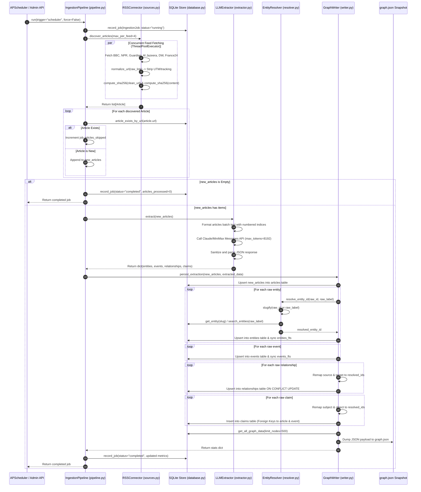
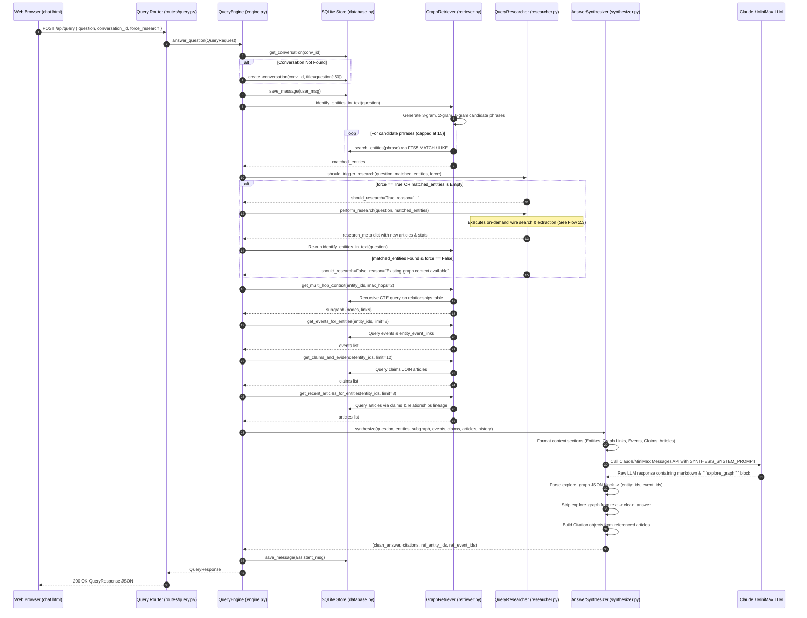
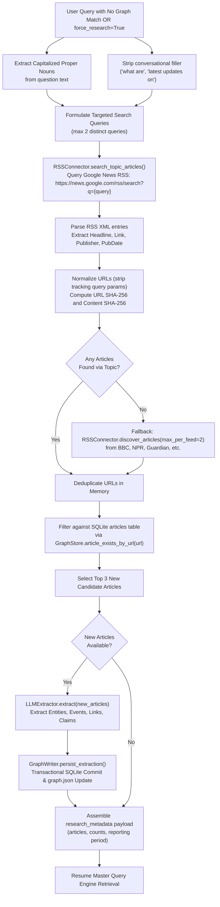

# DriftForge — Low-Level Design (LLD) Document
**Detailed Component, Function, Class & Data Flow Specifications**
*Version: 2.0.0 | Date: October 2026 | Document Status: Approved*

---

## 1. Introduction & Scope

This document provides the Low-Level Design (LLD) for the **DriftForge News Intelligence Platform**. It is the implementation-level counterpart to the High-Level Design (HLD). It details:
- **System-Wide & Intra-Component Data Flow Diagrams** covering the complete lifecycle of news ingestion, entity resolution, graph retrieval, query-triggered research, and response synthesis.
- **Exhaustive Module Catalog** detailing every module in the project codebase.
- **Detailed Function & Method Specifications** including exact parameter signatures, return types, step-by-step algorithmic logic, error handling, database operations, and external API calls.

---

## 2. System Data Flow Diagrams

### 2.1 Autonomous Background Ingestion Flow
This flow is executed periodically (hourly) by `server.scheduler` or triggered manually via `POST /api/ingest`.



---

### 2.2 Conversational Graph RAG Query Flow
This flow processes user inquiries submitted via `POST /api/query` from the Graph Chat workspace (`chat.html`).



---

### 2.3 Query-Triggered On-Demand News Research Flow
When a user asks about an emerging topic absent from the graph or explicitly clicks "Force Live Research", this flow executes synchronously within the query lifecycle.



---

### 2.4 3D Force Graph Visualizer & Deep Link Navigation Flow
Illustrates how the frontend visualizer initializes and responds to highlight deep links generated by the chat workspace.

```mermaid
sequenceDiagram
    autonumber
    participant User as Browser
    participant Page as index.html (Three.js ForceGraph3D)
    participant API as FastAPI Backend (/api/graph)
    participant Chat as chat.html

    User->>Page: Navigate to https://driftforge.cloud/?highlight=saudi-arabia,houthi-movement
    Page->>API: GET /api/graph?limit=500
    API-->>Page: Return GraphResponse { nodes, links, generated_at, entity_count }
    
    Page->>Page: Parse URL search parameters (?highlight=id1,id2)
    Page->>Page: Compute node degrees & apply quadratic radius: val = max(4, deg^2 + 4)
    Page->>Page: Run Label Propagation algorithm for community coloring
    Page->>Page: Mount WebGL canvas & initialize 3D Force Graph simulation
    
    alt Highlight IDs Present in URL
        Page->>Page: Extract target IDs = ['saudi-arabia', 'houthi-movement']
        Page->>Page: Identify 1-hop neighbor nodes connected via links
        Page->>Page: Apply dimming: set opacity = 0.08 on non-target nodes and links
        Page->>Page: Highlight target nodes: set bright glow & increased scale
        Page->>Page: Compute 3D bounding sphere around target nodes
        Page->>Page: Programmatically animate Three.js camera (tween to focus coordinates)
        Page->>Page: Populate Side Drawer with entity details and relationship table
    end

    User->>Chat: User asks question in Graph Chat